<p align="center"></p>

<h1 align="center">Btelo Forge</h1>

<p align="center">I put the programs of my own daily work into one small native app — even the ones I used Photoshop,
CapCut and OBS Studio for — and what one of them makes, the others can hold as a smart object that follows every
change.<br>
Free, open source, offline, and driven by AI over MCP.</p>

<p align="center">
  <a href="https://github.com/btelolabs/btelo-forge/releases/latest"><b>Download</b></a> ·
  <b>English</b> · <a href="README.zh-CN.md">中文</a>
</p>

> [!NOTE]
> **Windows is where Btelo Forge is made and checked. The macOS version is experimental:** it is tested far less,
> and screen recording, live streaming, the camera on the screen, screenshots and drawing on the screen are not there
> yet.

<p align="center">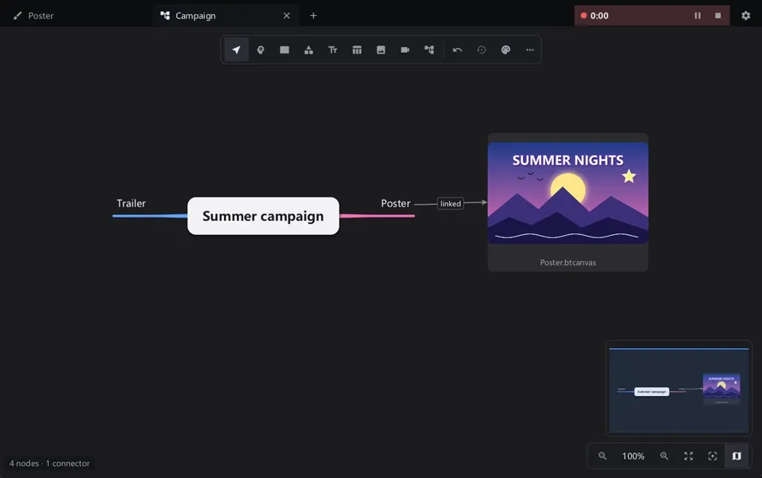</p>

A canvas shown on a mind map, drawn over a video or pasted into another canvas stays linked to it: draw on the canvas
and every place that shows it follows. Every animation on this page was recorded by Btelo Forge itself while an AI
drove it over MCP, then cut, sped up and exported as WebP by Btelo Forge.

## Video editing

<p align="center">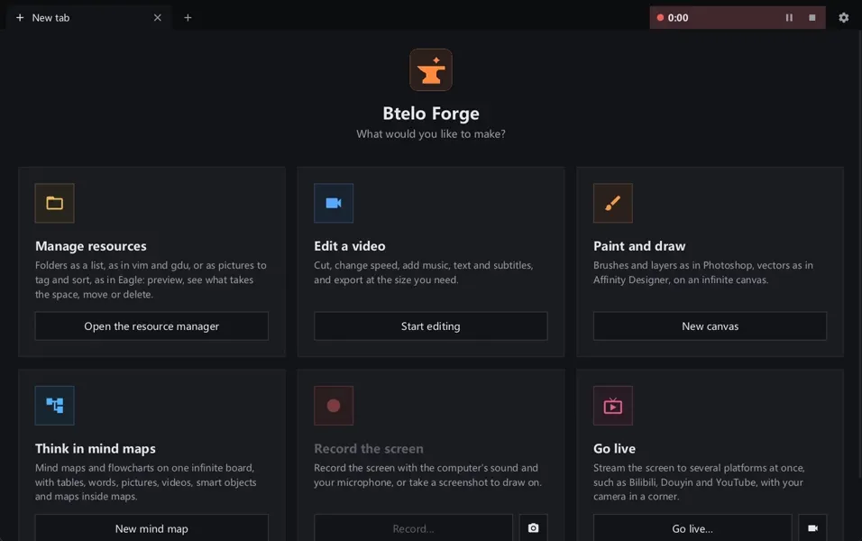</p>

- Tabs for separate edits, along the top or down the left side: drag them into any order, and right-click to pin one, which then opens again with the app holding what it held. Drop more videos to extend the main track or stack them on upper tracks.
- A multi-track timeline for video, overlays (text, images and drawings) and music; upper tracks cover lower ones.
- Split, trim and per-clip speed from 0.25× to 4×, with the sound's pitch kept.
- Volume per clip and per track, opacity for clips and overlays; box-select or Ctrl-click several items and change
  them together.
- Export presets from *High quality* to *Extreme compression*, or *Fit a size*, which aims for a file of a chosen
  size with two-pass encoding. Every setting is open: resolution, frame rate, H.264 / H.265 / AV1, quality, encoder
  speed and audio bitrate, with NVIDIA hardware encoding where there is one.
- Music from one search across Kevin MacLeod, Openverse, ccMixter, the Internet Archive and Freesound effects —
  only licences that allow commercial use, with the credits they ask for written next to each export.
- Subtitles from speech recognised on your own machine with whisper.cpp: six models, CPU or CUDA, on a track of
  their own, ready to edit.
- Voice-overs from text, or read straight from the subtitles, on your own graphics card (Vulkan): six voices or one
  you describe. By default Qwen3-TTS (Q8_0 or BF16, free for commercial use) runs on audio.cpp; Breeze TTS 2 (six
  sizes from Q4_K to F16, research and non-commercial use only) runs on Breeze-TTS-2.cpp. The model stays loaded for
  the next line and is unloaded after three idle minutes.
- Preview and export share one filter graph, so the export is what you saw.

<table>
  <tr>
    <td>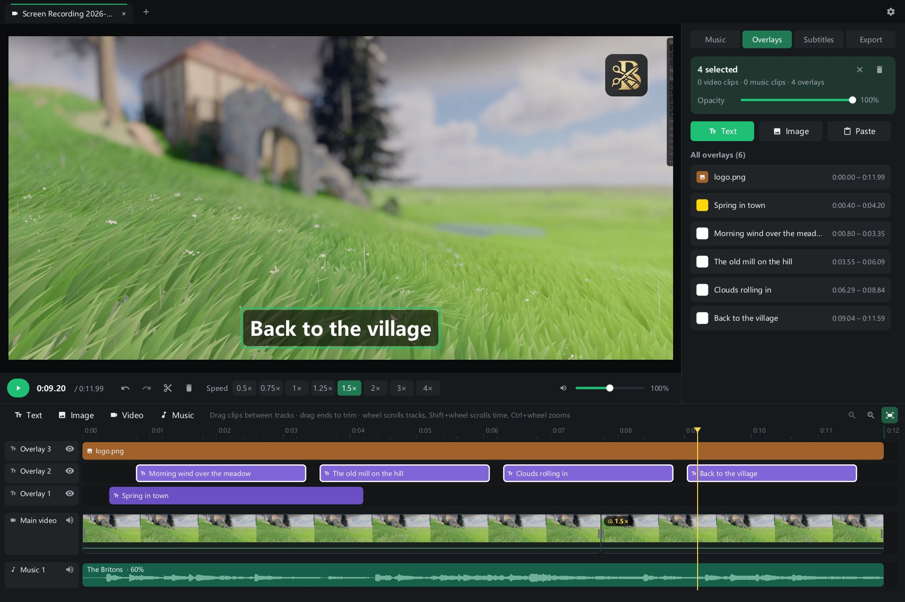</td>
    <td>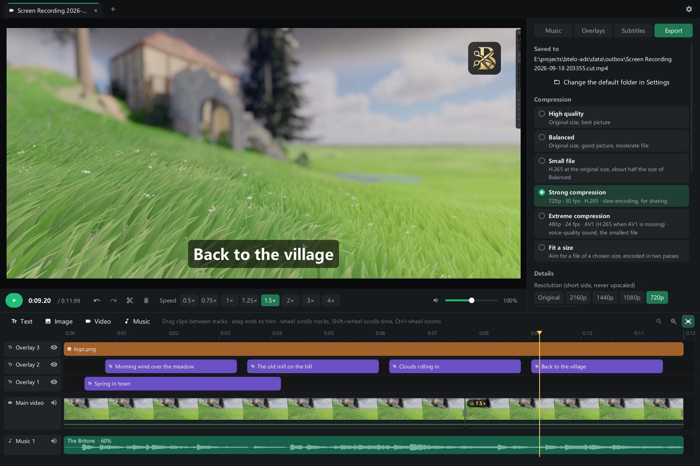</td>
  </tr>
</table>

## Painting and drawing

<p align="center"></p>

**Pixels, as in Photoshop**
- Brushes and an eraser with hardness, flow, smoothing, tip shape and shape dynamics (size and angle jitter,
  scatter, a tip that turns with the stroke); twelve brush presets from pencil, charcoal and ink to bristle brushes,
  sponge and spatter, and tips made from your own pictures; the clone stamp; the spot healing brush, healing brush, patch tool and content-aware fill, which take out blemishes, passers-by and clutter without a seam; dodge, burn, sponge, blur, sharpen and
  smudge; liquify (forward, pucker, bloat).
- Marquee, lasso and magic wand selections, and Select Subject and Remove Background by a local model (Windows, about 250 MB the first time, nothing uploaded), to feather, expand, contract, smooth or turn into a border; paint bucket and gradients.
- Layers and groups with masks, 26 blend modes and locked transparency; adjustment layers that change what is under
  them without touching its pixels; layer styles — drop and inner shadow, outer and inner glow, stroke, colour
  overlay — that follow every change to the layer.
- Levels, curves, exposure, vibrance, hue/saturation, color balance, photo filter, gradient map, selective color and shadows/highlights, a Develop panel for a whole photograph, and filters (the slow ones run on a graphics card when there is one) (Gaussian blur, unsharp mask, noise, mosaic), all with live
  previews; Free Transform with skew, distort, perspective and warp; a History panel.

**Vectors, as in Affinity Designer**
- Shapes (rectangle, ellipse, polygon, star, line), the pen, and a pencil that turns a freehand line into a few
  smooth curves.
- A node tool that chooses whole shapes and, after a double-click, their nodes and handles; Ctrl+T transforms just
  the chosen nodes or shapes; snapping to nodes, edges and centres.
- Combine shapes as in Photoshop — unite, subtract front, intersect, exclude — from the tools' bars with several
  vector layers chosen: the result stays true vector, every shape still editable, and combining is instant however
  large the layers are; Merge shape components bakes them into one outline.
- Fill and stroke settings — width, alignment, caps, joins, dashes. Vectors stay sharp at any zoom and in export.

**The canvas**
- Infinite: start drawing without choosing a size. Add artboards for fixed-size pictures, each exported on its own.
- Slices: K marks the chosen layers, groups and artboards, adding .png to their names, and File › Export slices
  writes each as a PNG beside the canvas file. Names follow the Krita named-assets rules — `assets/fish.png` into a
  folder, `fish_300x200.png` at a fixed size, a `200x300/assets` group handing its folder and size to what is in it —
  and the ⓘ by each slice says what it will export and why.
- Open a screenshot as a canvas, or draw over a video as an overlay that follows every save of its canvas.
- A canvas file keeps everything — layers, vectors, text, masks, effects, adjustment layers and artboards.
- Photoshop's PSD files open and export (RGB or grey, 8 or 16 bits) with their layers, groups, blend modes, opacity and masks. Adjustment layers and effects do not cross yet, and you are told what was left out.

<table>
  <tr>
    <td>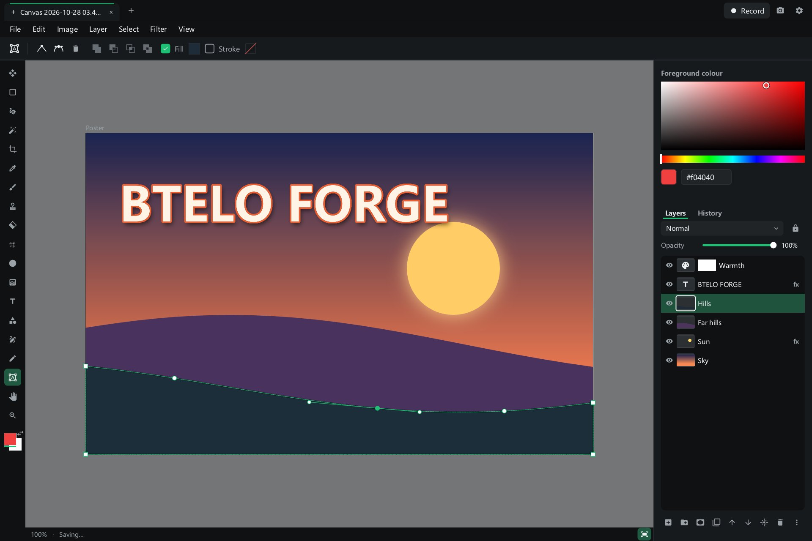</td>
    <td>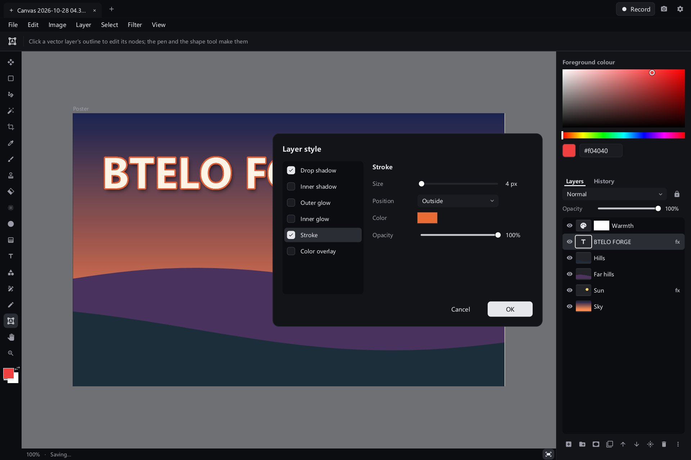</td>
  </tr>
</table>

## Office documents

- Word, Excel, PowerPoint and PDF in tabs, written in pure Go with nothing else to install. Files stay .docx, .xlsx and
  .pptx: what the app does not understand, such as comments, comes back out unchanged. Charts in all three are drawn,
  on the screen and as vectors on paper, and a chart in a workbook follows its cells; CSV and TSV files open as sheets and
  are saved back in their own encoding and separator.
- Documents: real pages with styles, lists, tables, pictures, headers and footers, find and replace.
- Spreadsheets: formulas with incremental recalculation, number formats, merged cells, frozen panes, sorting and
  filters, and files of millions of cells.
- Presentations: slides drawn from their masters and layouts, shapes, pictures, tables, speaker notes and a slideshow.
- PDFs: reading, searching, annotations other readers show, filling in forms, adding text and pictures, and turning,
  reordering, joining or removing pages.
- Documents save themselves a moment after each change, and the file as it was opened is kept in a backups folder.
  The old binary .doc, .xls and .ppt formats are not read.
- Printing: Ctrl+P prints Word, Excel, PowerPoint and PDF files, canvases and mind maps, with a preview that is the page
  itself, and any of them but a PDF saves as a vector PDF with searchable text. Shapes and words stay vector on paper;
  only what a printer cannot do, such as blend modes, goes as pixels. On macOS the PDF opens in the system's viewer,
  which prints it.

## Mind maps and flowcharts

<p align="center"></p>

- Mind maps and flowcharts on one infinite board, as XMind and Whimsical together: a tree's topic can have connectors,
  and a flowchart's box can grow a tree. Trees lay out as mind maps, logic charts, org charts or outlines.
- Everything on the board is a node: topics and flowchart shapes, free text, tables with formulas (=SUM(B2:B9)),
  pictures and animated GIFs, videos that play where they are, smart objects from your canvases, which follow every
  change you draw, and other mind maps shown inside — a map that ends up inside itself shows a warning instead.
- Nothing sits over the board: right-click it to add a topic, shape, text, table, picture or video there; the zoom bar
  at the bottom right also holds the themes and the map's other commands.
- Keys as in XMind: Tab adds a child, Enter a sibling, typing replaces a topic's words, arrows move between topics.
  Drag a topic onto another to move it there, or out onto the board to free it; drag from the dots at a box's sides
  to draw a connector, or onto empty board for a new connected box.
- Built for hundreds of thousands of nodes: the board is drawn from tiles on every core, only what is in view, with
  an overview of the whole board. Files are small: pictures and videos are referred to, never copied.
- Connectors find their own way round the nodes between their ends; drag a connector's middle to shape its route.
- Turn a branch into a task list: tick its topics off, and every level shows how much of what is under it is done.
- Six themes, from MindNode's dark look to white, pastel bubbles, ocean blue, sepia and neon, a click apart.
- Mind maps show in the asset manager with a picture of the whole map.

## Files

<p align="center"></p>

- Folder lists side by side, driven as gdu and vim are: hjkl or the arrows move, e opens another list beside. Each
  list shows its folder as rows, or as a grid of pictures filtered by kind, category or tag.
- i analyses what takes the space, as gdu does: the list is sorted by size with a bar for each item, and a pie of
  the folder sits under it. Move down the list with the keys or the mouse and the pie turns the item under the
  cursor to twelve o'clock, on a spring; click a wedge to go to its item.
- Copies, moves and deletions run in the background with their progress shown; deleted items go to the Recycle Bin,
  and u brings them back.

<p align="center">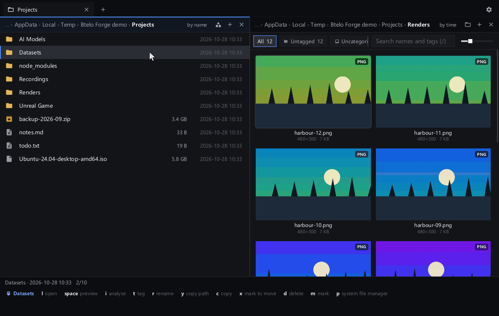</p>

## Screen recording (Windows)

<p align="center">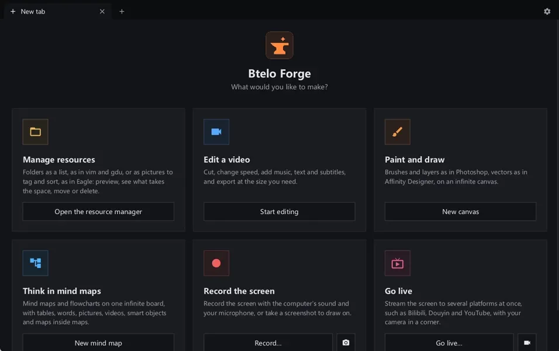</p>

- Records a screen with the computer's sound and a microphone, the way OBS Studio does: Desktop Duplication hands
  frames straight to the graphics card's encoder (NVIDIA NVENC, AMD AMF or Media Foundation), so recording a
  3440×1440 screen at 60 fps takes about 3% of one processor core.
- The whole screen or a region; pause and resume; hotkeys that work from any program (Ctrl+Shift+4 starts and
  stops). The editor's own window is recorded too, so its use can be shown; it can also keep itself out of the
  picture. The recording toolbar never appears in it.
- Recordings open in a tab, ready to cut.
- Screenshots of a dragged region of any screen, or all of one, onto the clipboard (Ctrl+Shift+3), into the pictures
  folder or saved with their path copied.
- Drawing on the screen (Ctrl+Shift+2), a tool of its own, while recording or not and ready for a screenshot: the
  whole canvas editor, with its menus, tools, colours, layers, dialogs and your keys, gathered on one tall panel that
  stays in front and out of recordings. The drawing is saved as a canvas.

## Live streaming (Windows)

<p align="center">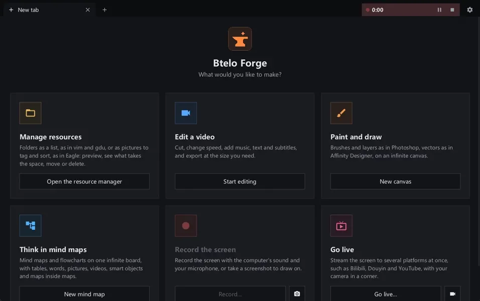</p>

- Streams to several platforms at once — YouTube, Twitch, Bilibili, Douyin, Kuaishou, WeChat Channels, Huya, Douyu,
  or any RTMP, RTMPS or SRT server. The picture is encoded once on the graphics card, so each extra platform costs
  only upload.
- Streaming and recording are separate, as in OBS: the stream shows the screen while it is recorded and black between
  recordings, and stopping a recording, or recording another part of the screen, never interrupts it.
- Each platform connects, reconnects and falls behind on its own; one that drops never holds up the others, and can
  be added or taken off while live. Stream keys are kept encrypted for your Windows account.
- The platforms are a JSON configuration: add one in Settings → Extensions, or let an AI add it.
- Your camera can sit on the screen in a corner, as a circle or a rounded rectangle with a border, so recordings and
  streams of the screen have it. Drag it to move it, drag its corner or turn the wheel over it to resize it.

## AI control over MCP

- A built-in MCP server lets Claude, Codex, Cursor or any MCP client do what you can do with the mouse: edit videos,
  paint and draw on canvases, build and keep up mind maps, record the screen, and look at the result.
- Each kind of work has its own server — video editing, drawing, mind maps, recording, or everything — so an AI hears only
  about the tools it needs. Settings copies the setup for it, ready to paste.
- Music sites, speech models, streaming platforms and the ffmpeg download source are plain JSON that an AI (or you,
  in Settings) can change. Stream keys given to an AI are stored encrypted and never shown to it again.

<table>
  <tr>
    <td>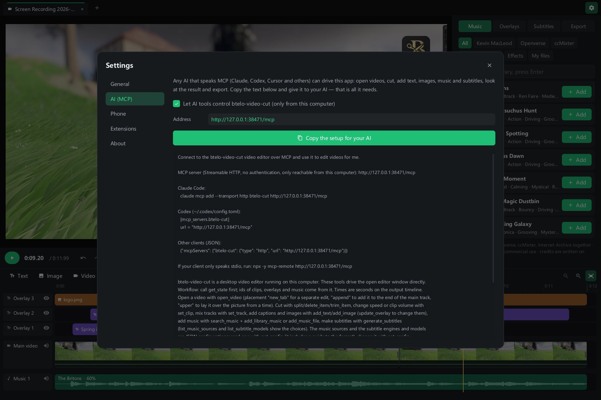</td>
    <td>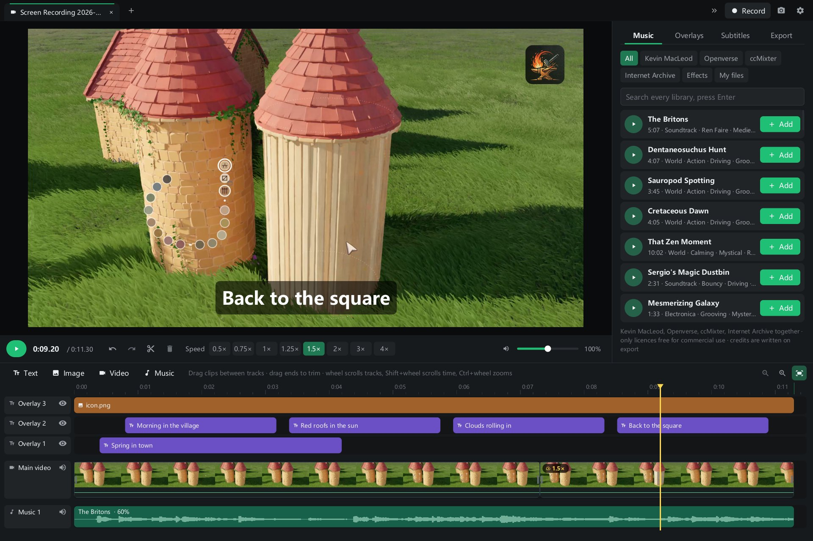</td>
  </tr>
</table>

## Also

- Local models, a tool opened from the start page: a chat window like ChatGPT's, with Qwen3, Gemma 3, Phi-4 mini and
  Llama 3.2 running on your own computer through llama.cpp (Vulkan on NVIDIA, AMD and Intel graphics cards, or the
  processor), and with Gemini, Grok, DeepSeek and Qwen online using your own API key, which is kept sealed for your
  Windows account. A model downloads the first time it is used, resuming after an interruption, and is loaded, switched
  and unloaded from the chat; while it is loaded the disk, memory, processor, graphics processor and video memory it
  takes are shown. Settings → AI models lists every model of the app, including the voice-over and subtitle ones, with
  whether it runs and what it costs. Answers stream in, thinking models show their thinking apart, and conversations are
  kept on this computer. The list of models, engines and services is a JSON configuration (Settings → Extensions, or
  `ai_models` over MCP).
- A 3D tool opened from the start page, for making and changing assets: .glb, .gltf and .fbx files open and save (FBX written
  and checked against Blender both ways). Points, edges and faces are edited with extrude, inset, bevel, loop cut, bridge,
  mirror and subdivision; seams, unwrapping and a UV editor lay out textures, which you paint on the model, or in the drawing
  tool with all its layers. Bones are made and bound, weights painted, poses keyed on a timeline, with IK. Five skies or your
  own, and a path traced view with light that bounces, which runs on your graphics card through WebGPU.
- Keyboard rules, a tool opened from the start page and off until you turn them on: one line each, such as `CapsLock -> Esc`,
  `Ctrl+Alt+T -> open "wt.exe"` or `;mail => me@example.com`, working in every program. Example buttons add a rule to
  change, key names complete as you type, a mistake is pointed out when saving, and saved rules apply at once; an AI
  can change them over MCP. The same tab writes registry remaps as SharpKeys does, taking effect after a restart,
  or hidutil remaps on macOS, with nothing running.
- Keyboard shortcuts chosen in Settings for each kind of work on its own: general, video editing, drawing and
  recording.
- Your phone can play and download exports, and send clips back to the computer, over the local network with a
  private link.
- A window in the background uses no processor time: nothing is drawn or checked until something changes.

## Download

| System | File |
| --- | --- |
| Windows 10 / 11, x64 | `btelo-forge-windows-amd64.zip` |
| Windows on ARM | `btelo-forge-windows-arm64.zip` |
| macOS 11+, Apple silicon and Intel (experimental) | `btelo-forge-macos.zip` |

There is nothing else to install. The app uses its own ffmpeg, so that recording, streaming and exporting work the
same on every computer: a static build is downloaded once into the app's own folder (Settings → Extensions → ffmpeg
can allow the one installed on the computer instead). The macOS app is signed and notarised by Apple. On macOS, AI subtitles use `whisper-cli` from
Homebrew, and voice-overs the macOS download of [audio.cpp](https://github.com/0xShug0/audio.cpp/releases) (or, for
Breeze, a `breeze-server` built from [Breeze-TTS-2.cpp](https://github.com/HoppouAI/Breeze-TTS-2.cpp)) on the PATH.

The app keeps itself up to date: once a day, or from Settings → About, it asks GitHub for the newest release and
offers it. Agreed to, the release is downloaded, checked against the checksum GitHub publishes with it, put in place of
the installed copy, and the app restarts as the new version once recording, streaming, exporting and other work have
ended. On macOS this needs the app in a folder you can change, such as Applications.

Btelo Forge was called Btelo Video Cut; releases up to 0.1.3 carry that name (`btelo-cut-*.zip`). Its settings,
unfinished edits and downloads move over the first time Btelo Forge runs. On macOS the app has a new identity, so it
asks again for permission to record the screen.

## Build

Requires Go 1.27. Windows needs nothing else; macOS needs the Xcode command-line tools.

```
go build ./cmd/btelo-forge
go test ./...
```

On Windows, `scripts\dev.ps1` builds the working tree and opens it; `-InstallShortcut` puts a desktop shortcut
that does the same, so a change can be tried with a double-click.

Pure Go on Windows (Win32, no cgo) and Cocoa on macOS. The interface is drawn in software, and ffmpeg does all
media work. [docs/canvas-engine.md](docs/canvas-engine.md) describes how the canvas works.

## Licence

[Apache License 2.0](LICENSE). Third-party components keep their own licences; see
[third-party notices](THIRD_PARTY_NOTICES.md).
