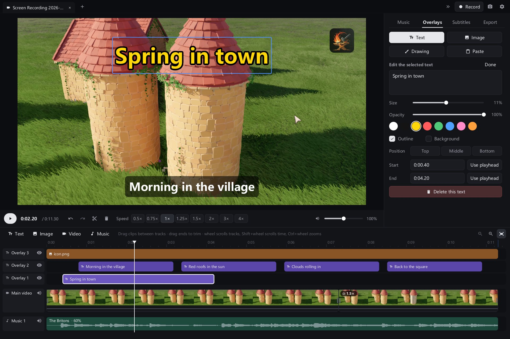
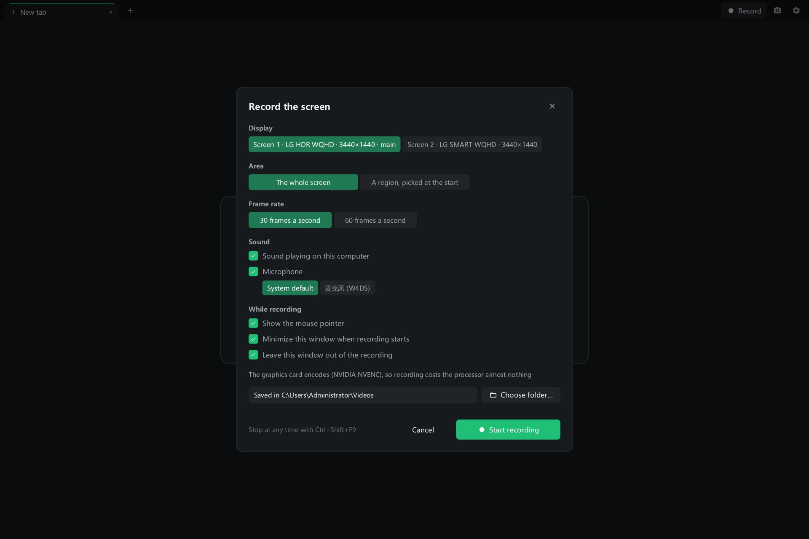

<p align="center"></p>

<h1 align="center">Btelo Forge</h1>

<p align="center">Edit video, paint and draw, record the screen — in one small, native app for Windows and macOS.<br>
Free, open source, offline, and driven by AI over MCP.</p>

<p align="center">
  <a href="https://github.com/btelolabs/btelo-forge/releases/latest"><b>Download</b></a> ·
  <b>English</b> · <a href="README.zh-CN.md">中文</a>
</p>

<p align="center"></p>

## Video editing

- Tabs for separate edits; drop more videos to extend the main track or stack them on upper tracks.
- A multi-track timeline for video, overlays (text, images and drawings) and music; upper tracks cover lower ones.
- Split, trim and per-clip speed from 0.25× to 4×, with the sound's pitch kept.
- Volume per clip and per track, opacity for clips and overlays; box-select or Ctrl-click several items and change
  them together.
- Export presets from *High quality* to *Extreme compression*, or *Fit a size*, which aims for a file of a chosen
  size with two-pass encoding. Every setting is open: resolution, frame rate, H.264 / H.265 / AV1, quality, encoder
  speed and audio bitrate, with NVIDIA hardware encoding where there is one.
- Music from one search across Kevin MacLeod, Openverse, ccMixter, the Internet Archive and Freesound effects —
  only licences that allow commercial use, with the credits they ask for written next to each export.
- Subtitles from speech recognised on your own machine with whisper.cpp: six models, CPU or CUDA, on a track of
  their own, ready to edit.
- Preview and export share one filter graph, so the export is what you saw.

<table>
  <tr>
    <td></td>
    <td></td>
  </tr>
</table>

## Painting and drawing

<p align="center"></p>

**Pixels, as in Photoshop**
- Brushes and an eraser with hardness, flow, smoothing and tip shape; the clone stamp; dodge, burn, sponge, blur,
  sharpen and smudge.
- Marquee, lasso and magic wand selections; paint bucket and gradients.
- Layers and groups with masks, 26 blend modes and locked transparency; adjustment layers that change what is under
  them without touching its pixels; layer styles — drop and inner shadow, outer and inner glow, stroke, colour
  overlay — that follow every change to the layer.
- Levels, curves, hue/saturation and more, and filters (Gaussian blur, unsharp mask, noise, mosaic), all with live
  previews; Free Transform with skew, distort, perspective and warp; a History panel.

**Vectors, as in Affinity Designer**
- Shapes (rectangle, ellipse, polygon, star, line), the pen, and a pencil that turns a freehand line into a few
  smooth curves.
- A node tool for nodes and handles, booleans (add, subtract, intersect, exclude) and snapping to nodes, edges and
  centres.
- Fill and stroke settings — width, alignment, caps, joins, dashes. Vectors stay sharp at any zoom and in export.

**The canvas**
- Infinite: start drawing without choosing a size. Add artboards for fixed-size pictures, each exported on its own.
- Open a screenshot as a canvas, or draw over a video as an overlay that follows every save of its canvas.
- A canvas file keeps everything — layers, vectors, text, masks, effects, adjustment layers and artboards.

<p align="center"></p>

## Screen recording (Windows)

- Records a screen with the computer's sound and a microphone, the way OBS Studio does: Desktop Duplication hands
  frames straight to the graphics card's encoder (NVIDIA NVENC, AMD AMF or Media Foundation), so recording a
  3440×1440 screen at 60 fps takes about 3% of one processor core.
- The whole screen or a region; pause and resume; hotkeys that work from any program (Ctrl+Shift+F9 starts and
  stops). The editor's own window is recorded too, so its use can be shown; it can also keep itself out of the
  picture. The recording toolbar never appears in it.
- Recordings open in a tab, ready to cut.
- Screenshots of a screen or a dragged region, and drawing on the screen itself, with or without recording.

<p align="center"></p>

## AI control over MCP

- A built-in MCP server lets Claude, Codex, Cursor or any MCP client do what you can do with the mouse: edit videos,
  paint and draw on canvases, record the screen, and look at the result.
- Each kind of work has its own server — video editing, drawing, recording, or everything — so an AI hears only
  about the tools it needs. Settings copies the setup for it, ready to paste.
- Music sites, speech models and the ffmpeg download source are plain JSON that an AI (or you, in Settings) can
  change.

<table>
  <tr>
    <td></td>
    <td></td>
  </tr>
</table>

## Also

- Keyboard shortcuts chosen in Settings for each kind of work on its own: general, video editing, drawing and
  recording.
- Your phone can play and download exports, and send clips back to the computer, over the local network with a
  private link.
- A window in the background uses no processor time: nothing is drawn or checked until something changes.

## Download

| System | File |
| --- | --- |
| Windows 10 / 11, x64 | `btelo-forge-windows-amd64.zip` |
| Windows on ARM | `btelo-forge-windows-arm64.zip` |
| macOS 11+, Apple silicon and Intel | `btelo-forge-macos.zip` |

There is nothing else to install. If ffmpeg is missing or older than 6.0, a static build is downloaded once into the
app's own folder. The macOS app is signed and notarised by Apple. On macOS, AI subtitles use `whisper-cli` from
Homebrew.

Btelo Forge was called Btelo Video Cut; releases up to 0.1.3 carry that name (`btelo-cut-*.zip`). Its settings,
unfinished edits and downloads move over the first time Btelo Forge runs. On macOS the app has a new identity, so it
asks again for permission to record the screen.

## Build

Requires Go 1.27. Windows needs nothing else; macOS needs the Xcode command-line tools.

```
go build ./cmd/btelo-forge
go test ./...
```

On Windows, `scripts\dev.ps1` builds the working tree and opens it; `-InstallShortcut` puts a desktop shortcut
that does the same, so a change can be tried with a double-click.

Pure Go on Windows (Win32, no cgo) and Cocoa on macOS. The interface is drawn in software, and ffmpeg does all
media work. [docs/canvas-engine.md](docs/canvas-engine.md) describes how the canvas works.

## Licence

[Apache License 2.0](LICENSE). Third-party components keep their own licences; see
[third-party notices](THIRD_PARTY_NOTICES.md).
