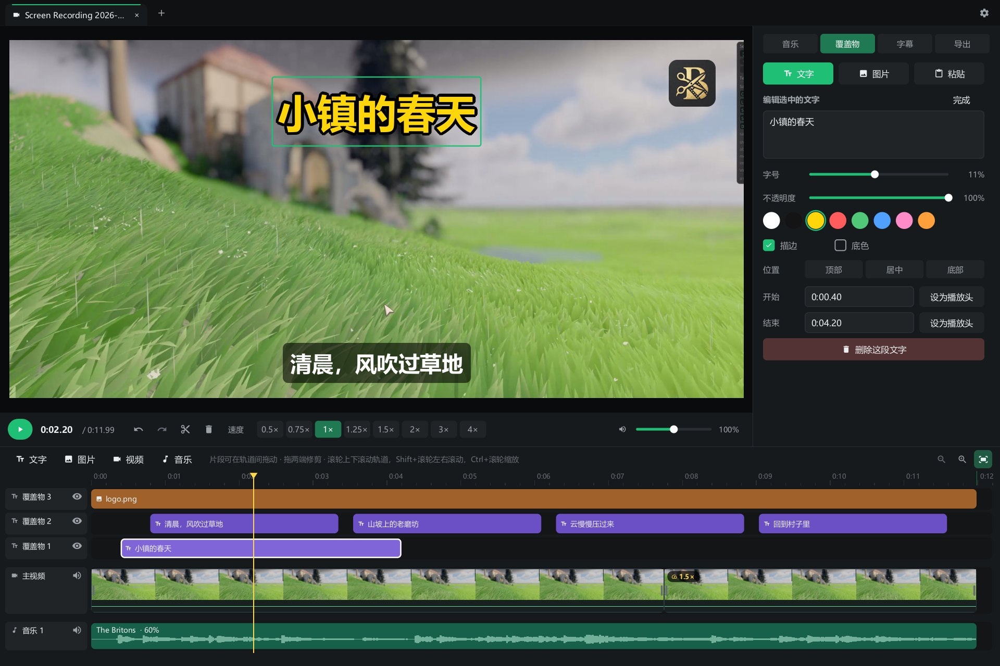
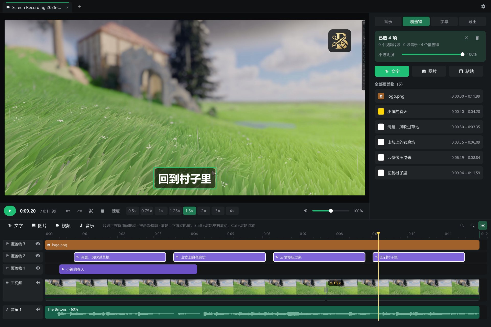
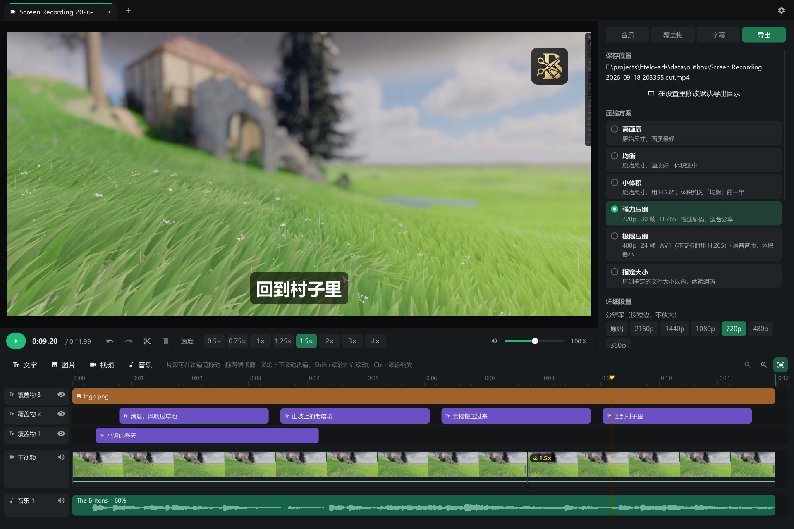
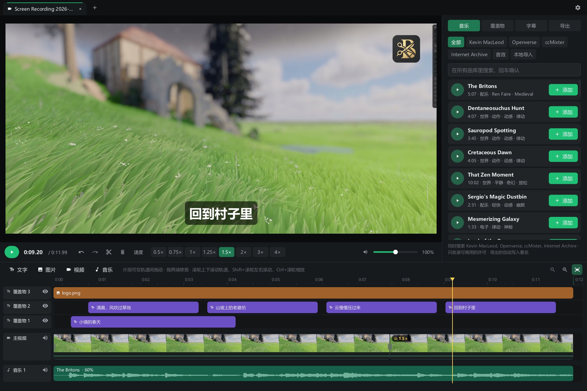
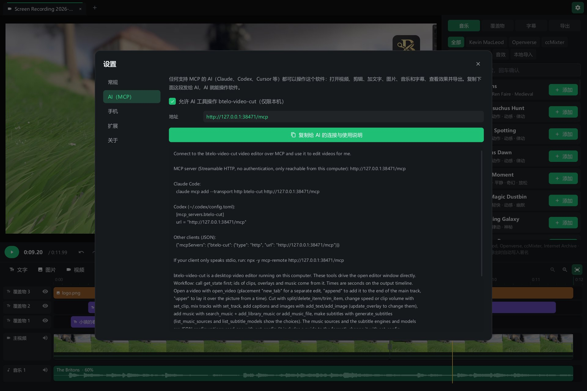

<p align="center"></p>

<h1 align="center">btelo-video-cut</h1>

<p align="center">小而快的视频剪辑软件，支持 Windows 和 macOS。原生、离线可用，AI 可以直接操作。</p>

<p align="center">
  <a href="https://github.com/btelolabs/btelo-video-cut/releases/latest"><b>下载</b></a> ·
  <a href="README.md">English</a> · <b>中文</b>
</p>

<p align="center"></p>

## 特性

**剪辑**
- 标签页，各自独立的剪辑；再拖入视频，可以接在主轨末尾，也可以叠到上层轨道。
- 多轨时间线：视频、覆盖物（文字与图片）、音乐，上层轨道盖住下层。
- 分割、修剪、单片段 0.25×–4× 变速，声音变速不变调。
- 片段和整条轨道都能调音量，视频片段和覆盖物都能调不透明度。
- 框选或 Ctrl 多选，一起删除、一起调音量和不透明度。
- 预览和导出用同一套滤镜图，看到什么就导出什么。

**压缩**
- 从「高画质」到「极限压缩」的预设，另有「指定大小」：两遍编码，压到你设定的文件大小以内。
- 所有参数都可以单独调：分辨率、帧率、H.264 / H.265 / AV1、五档画质、编码速度、音频码率。
- 支持 NVIDIA 显卡编码，并记住上一次的设置。

**声音与字幕**
- 一次搜索 Kevin MacLeod、Openverse、ccMixter、Internet Archive 和 Freesound 音效。
- 只收录可商用的许可，导出时自动在旁边写好需要的署名。
- 本机用 whisper.cpp 识别语音，六种模型可选，支持 CPU 或 CUDA；字幕放在单独的轨道上，可以继续编辑。

**窗口之外**
- 内置 MCP 服务：Claude、Codex、Cursor 等 MCP 客户端可以打开视频、剪辑、加字幕、配乐、导出，每个功能都有对应工具。
- 手机在同一局域网里通过带私密口令的链接，播放和下载导出的视频，也能把视频传回电脑。
- 音乐网站、语音模型和 ffmpeg 下载来源都是纯 JSON 配置，可以在设置里改，也可以让 AI 改。

<table>
  <tr>
    <td></td>
    <td></td>
  </tr>
  <tr>
    <td></td>
    <td></td>
  </tr>
</table>

## 下载

| 系统 | 文件 |
| --- | --- |
| Windows 10 / 11，x64 | `btelo-cut-windows-amd64.zip` |
| Windows ARM 版 | `btelo-cut-windows-arm64.zip` |
| macOS 11 及以上，Apple 芯片与 Intel | `btelo-cut-macos.zip` |

不需要另外安装任何东西：没有 ffmpeg 或版本低于 6.0 时，软件会自动下载一份静态版本到它自己的目录，只下载一次。
macOS 版暂未公证，第一次请右键 → **打开**。macOS 上的 AI 字幕使用 Homebrew 安装的 `whisper-cli`。

## 构建

需要 Go 1.27。Windows 不需要别的；macOS 需要 Xcode 命令行工具。

```
go build ./cmd/btelo-video-cut
go test ./...
```

Windows 上是纯 Go 实现（Win32，不用 cgo），macOS 上使用 Cocoa；界面由软件自己绘制，媒体处理全部交给 ffmpeg。

## 许可

可以免费使用，包括制作商业视频；源代码公开，可以阅读、修改后自己使用；禁止再分发和销售。详见 [LICENSE](LICENSE)
和[第三方声明](THIRD_PARTY_NOTICES.md)。
