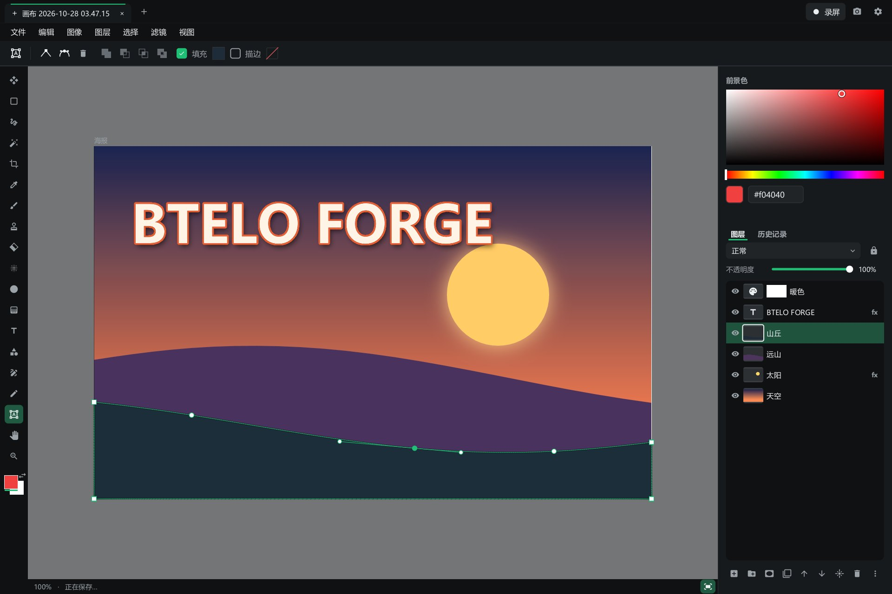
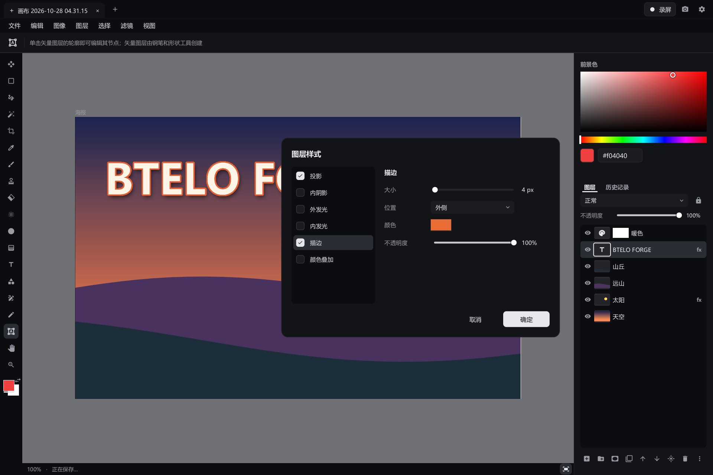
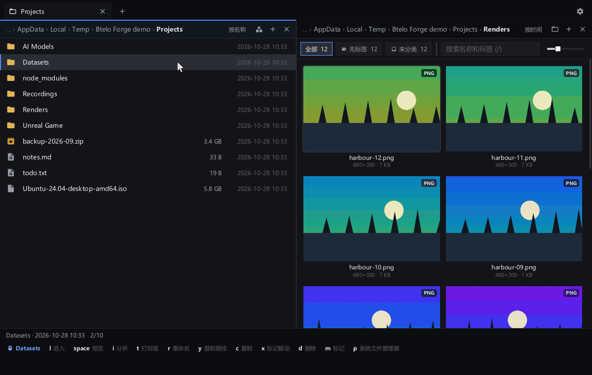

<p align="center"></p>

<h1 align="center">Btelo Forge</h1>

<p align="center">我把自己日常工作流里常用的软件——哪怕是 Photoshop、剪映和 OBS——都集合进了一个小巧的原生程序，<br>
而且其中一个做出来的东西，可以作为智能对象被其它几个引用，改一处、处处跟着变。<br>
免费开源、离线可用，AI 也能通过 MCP 直接操作。</p>

<p align="center">
  <a href="https://github.com/btelolabs/btelo-forge/releases/latest"><b>下载</b></a> ·
  <a href="README.md">English</a> · <b>中文</b>
</p>

> [!NOTE]
> **Btelo Forge 在 Windows 上开发和验证。macOS 版是实验性的：** 验证得少得多，录屏、直播、屏幕上的摄像头画面、
> 屏幕截图和在屏幕上绘制都还没有。

<p align="center"></p>

画布放进脑图、画在视频上、或粘贴进另一张画布后，都和原画布保持关联：在画布上一改，所有引用它的地方都跟着变。本页所有动图都由
Btelo Forge 自己录制——AI 通过 MCP 操作软件，再由 Btelo Forge 剪辑、加速、导出为 WebP（界面为英文）。

## 视频剪辑

<p align="center"></p>

- 标签页，各自独立的剪辑，可以放在顶部或左侧：拖动调整顺序，右键固定后，重启应用会自动打开并恢复原来的内容。再拖入视频，可以接在主轨末尾，也可以叠到上层轨道。
- 多轨时间线：视频、覆盖物（文字、图片和绘图）、音乐，上层轨道盖住下层。
- 分割、修剪、单片段 0.25×–4× 变速，声音变速不变调。
- 片段和整条轨道都能调音量，片段和覆盖物都能调不透明度；框选或 Ctrl 多选后一起修改。
- 导出预设从「高画质」到「极限压缩」，另有「指定大小」：两遍编码，压到你设定的文件大小以内。所有参数都可以单独调：分辨率、帧率、H.264 / H.265 / AV1、画质、编码速度、音频码率，有 NVIDIA 显卡时用显卡编码。
- 配乐：一次搜索 Kevin MacLeod、Openverse、ccMixter、Internet Archive 和 Freesound 音效，只收录可商用的许可，导出时自动在旁边写好需要的署名。
- 字幕：本机用 whisper.cpp 识别语音，六种模型，CPU 或 CUDA；字幕放在单独的轨道上，可以继续编辑。
- 配音：用本机显卡（Vulkan）把文字或现有字幕变成语音；六种音色，也可以自己描述音色。默认用 audio.cpp 运行 Qwen3-TTS（Q8_0 或 BF16，可以免费商用）；也可以用 Breeze-TTS-2.cpp 运行 Breeze TTS 2（Q4_K 到 F16 六档，只能用于研究和非商业用途）。模型载入后会留着给下一句用，闲置三分钟自动卸载。
- 预览和导出用同一套滤镜图，看到什么就导出什么。

<table>
  <tr>
    <td></td>
    <td></td>
  </tr>
</table>

## 绘图

<p align="center"></p>

**位图，像 Photoshop 一样**
- 画笔与橡皮擦（硬度、流量、平滑、笔尖形状、形状动态：大小与角度抖动、散布、笔尖随笔画转动）；12 个笔刷预设（铅笔、炭笔、针管笔、毛笔、鬃毛刷、海绵、喷溅等），也可用自己的图片做笔尖；仿制图章；污点修复画笔、修复画笔、修补工具和内容识别填充，去掉瑕疵、路人和杂物时看不出接缝；减淡、加深、海绵、模糊、锐化、涂抹；液化（向前变形、褶皱、膨胀）。
- 矩形/椭圆选框、套索、魔棒选区，以及用本地模型一键选择主体或去背景（Windows，首次下载约 250 MB，发丝级，不上传图片）；选区可羽化，也可扩展、收缩、平滑和取边界；油漆桶和渐变。
- 图层与编组，支持蒙版、26 种混合模式和锁定透明像素；调整图层只改变下方的显示效果、不动原像素；智能对象上的滤镜和调整是智能滤镜，随时可改、可关、可调顺序、可删除；图层样式（投影、内阴影、外发光、内发光、描边、颜色叠加）随图层的每次修改自动更新。
- 色阶、曲线、曝光度、自然饱和度、色相/饱和度、色彩平衡、照片滤镜、渐变映射、可选颜色、阴影/高光等调整，一个面板调完整张照片的「照片调整」，高斯模糊、USM 锐化、添加杂色、马赛克等滤镜，都带实时预览，大图上的慢滤镜有显卡时自动用显卡；自由变换含斜切、扭曲、透视、变形；历史记录面板。

**矢量，像 Affinity Designer 一样**
- 形状（矩形、椭圆、多边形、星形、直线）、钢笔，以及把手绘线条变成少量平滑曲线的铅笔。
- 节点工具单击选中整个形状、双击进入编辑节点和控制柄；Ctrl+T 只变换选中的节点或形状；吸附到节点、边和中心。
- 和 Photoshop 一样的合并形状——统一形状、减去顶层形状、统一重叠处形状、减去重叠处形状：选中多个矢量图层后在工具栏上一键完成，结果仍是真正的矢量、每个形状都能继续编辑，合并本身瞬间完成、与图层大小无关；「合并形状组件」再烘焙成一条轮廓。
- 填充与描边设置：宽度、对齐、端点、拐角、虚线。矢量在任何缩放和导出中都保持清晰。

**画布**
- 无限画布：开始画之前不用设定尺寸。需要固定尺寸时加画板，每个画板单独导出为一张图片。
- 切图：按 K 把选中的图层、组或画板标记为切图（名字末尾自动加 .png），文件 › 导出切图 把它们逐个导出为 PNG，放在画布文件旁边。命名沿用 Krita 切图插件的规则——`assets/fish.png` 导出到子目录、`fish_300x200.png` 指定尺寸、`200x300/assets` 组把目录和尺寸传给其中的图层——每个切图旁的 ⓘ 会说明它将导出成什么、为什么是这个尺寸。
- 截图可以直接作为画布打开；也可以在视频上绘制覆盖物，画布每次保存，覆盖物随之更新。
- 画布文件完整保存所有内容：图层、矢量、文字、蒙版、效果、调整图层和画板。
- 打开和导出 Photoshop 的 PSD 文件（RGB 或灰度，8 或 16 位）：图层、分组、混合模式、不透明度和蒙版都保留；调整图层和效果目前不会带过去，打开或导出时会告诉你少了什么。

<table>
  <tr>
    <td></td>
    <td></td>
  </tr>
</table>

## Office 文档

- Word、Excel、PowerPoint 和 PDF 都在标签页里编辑，纯 Go 实现，无需另装软件。文件保持 .docx、.xlsx、.pptx 格式，应用不认识的内容（如批注）保存后原样保留。三种文件里的图表都能显示，打印时是矢量，表格里的图表随单元格更新；CSV、TSV 按表格打开，保存时保持原来的编码和分隔符。
- 文档：真实分页，支持样式、列表、表格、图片、页眉页脚、查找替换。
- 表格：公式增量重算、数字格式、合并单元格、冻结窗格、排序筛选，可打开数百万单元格的文件。
- 演示文稿：按母版和版式绘制幻灯片，支持形状、图片、表格、演讲者备注和全屏放映。
- PDF：阅读、搜索、其它阅读器也能看到的批注、填写表单、添加文字和图片，以及旋转、重排、合并、删除页面。
- 文档在每次修改后不久自动保存，打开时的原文件会保留在备份文件夹中。不支持读取旧版二进制 .doc、.xls、.ppt。
- 打印：Ctrl+P 可打印 Word、Excel、PowerPoint、PDF、画布和脑图，预览就是页面本身；除 PDF 外都能存为矢量 PDF，文字可搜索。形状和文字在纸上保持矢量，只有打印机做不到的效果（如混合模式）才用像素。macOS 上 PDF 在系统查看器中打开，由它打印。

## 脑图与流程图

<p align="center"></p>

- 思维导图和流程图同在一块无限画板上，像 XMind 加 Whimsical：导图里的主题可以连线，流程图的方框也能长出子树。树可以排成思维导图、逻辑图、组织结构图或大纲。
- 画板上的一切都是节点：主题和流程图形状、自由文字、带公式的表格（=SUM(B2:B9)）、图片和 GIF 动图、原地播放的视频、来自画布的智能对象（画布上每次修改都会同步过来），以及嵌套在里面的其它脑图——脑图如果绕一圈嵌套回自己，会显示一个 ⚠️ 提示节点，不会出错。
- 画板上方不放任何按钮：在画板上右键即可在该处添加主题、形状、文字、表格、图片或视频；右下角的缩放栏里还有主题和导图的其他命令。
- 快捷键与 XMind 一致：Tab 添加子主题、Enter 添加同级主题、直接打字替换主题文字、方向键在主题间移动。把主题拖到另一个主题上就移过去，拖到空白处就变成自由节点；从方框四边的圆点拖出连线，拖到空白处会新建一个连好的方框。
- 为几十万个节点设计：画板按瓦片在所有 CPU 核心上绘制，只画视野内的部分，并有整块画板的缩略图。文件很小：图片和视频只是引用，从不复制。
- 连线会自动绕开两端之间的其它节点；拖动连线中间的手柄可以调整它的走向。
- 可以把一个分支变成任务清单：逐个勾选完成，每一层都显示下面的完成比例。
- 六套主题：MindNode 风格的深色、纯白、粉彩气泡、海洋蓝、复古和霓虹，点一下就切换。
- 素材管理里可以预览脑图，网格里显示整张脑图的缩略图。

## 文件管理

<p align="center"></p>

- 多个文件夹列表并排，操作方式像 gdu 和 vim：hjkl 或方向键移动，e 在旁边再开一个列表。每个列表可以按行显示，也可以显示成按类型、分类或标签筛选的图片网格。
- 按 i 分析空间占用，像 gdu 一样：列表按大小排序，每项带一条占比条，列表下方是这个文件夹的饼图。用键盘或鼠标在列表里移动，饼图会以弹簧动画把光标所在的那一项转到 12 点方向并微微放大；点一下扇区就跳到对应的那一项。
- 复制、移动、删除都在后台进行并显示进度；删除的东西进回收站，按 u 可以恢复。

<p align="center"></p>

## 录屏（Windows）

<p align="center"></p>

- 录制屏幕，同时录电脑声音和麦克风，做法与 OBS Studio 相同：桌面复制（Desktop Duplication）把画面直接交给显卡编码（NVIDIA NVENC、AMD AMF 或 Media Foundation），实测录制 3440×1440、每秒 60 帧只占单核处理器约 3%。
- 整个屏幕或选定区域；可以暂停和继续；在任何程序里都能用的热键（Ctrl+Shift+4 开始和停止）；本软件的窗口默认也会录进去，方便录制操作演示，也可以设置成不录；录制工具栏不会出现在画面里。
- 录完直接在新标签页打开，马上可以剪辑。
- 在任一屏幕上拖选区域或截取整个屏幕，可以截到剪贴板（Ctrl+Shift+3）、存到图片目录，或存好后复制图片路径。
- 屏幕绘制（Ctrl+Shift+2）是独立的工具，录屏或不录屏时都能用，画完可以直接截图：完整的画布编辑器：菜单、工具、颜色、图层、对话框和你设置的快捷键都聚合在一个竖向长面板上，面板始终在最前面，也不会被录进去。画好的内容按画布文件保存。

## 直播推流（Windows）

<p align="center"></p>

- 一播多推：同时推到 YouTube、Twitch、B 站、抖音、快手、视频号、虎牙、斗鱼，或任何 RTMP、RTMPS、SRT 服务器。画面只在显卡上编码一次，多推一个平台只多占上传带宽。
- 推流和录制互相独立，做法与 OBS 相同：录制时直播画面就是正在录的屏幕，不录时为黑屏；停止录制、或换个区域重新录制，都不会中断直播。
- 每个平台各自连接、断线自动重连、各自追赶进度，一个掉线不会拖累其他平台，直播中也能单独加入或停推某个平台。串流密钥以你的 Windows 账户加密保存。
- 平台列表是 JSON 配置：在 设置 → 扩展 里添加新平台，或者让 AI 帮你加。
- 摄像头可以以圆形或带描边的圆角矩形放在屏幕一角，录屏和直播都会带上；拖动可移动，拖右下角或滚动滚轮可调大小。

## AI 通过 MCP 操作

- 内置 MCP 服务：Claude、Codex、Cursor 等 MCP 客户端能做你用鼠标能做的事——剪辑视频、在画布上绘图、绘制和维护脑图、录制屏幕，并查看结果。
- 视频剪辑、绘图、脑图、录制、Office 文档（以及全部）各有独立的服务，AI 只会看到它需要的工具；设置里可以一键复制给 AI 的接入说明。
- 音乐网站、语音模型、直播平台和 ffmpeg 下载来源都是纯 JSON 配置，可以让 AI 改，也可以自己在设置里改。交给 AI 的串流密钥会加密保存，之后不会再显示给它。

<table>
  <tr>
    <td></td>
    <td></td>
  </tr>
</table>

## 其他

- 本地模型，是从主页打开的工具：一个类似 ChatGPT 的聊天窗口，可以用 llama.cpp 在你自己的电脑上运行 Qwen3、Gemma 3、Phi-4 mini、Llama 3.2（NVIDIA、AMD、Intel 显卡走 Vulkan，也可以只用处理器），也可以用你自己的 API 密钥接入在线的 Gemini、Grok、DeepSeek 和通义千问，密钥按你的 Windows 账户加密保存。模型第一次使用时自动下载，中断后能接着下；在聊天里就能加载、切换和卸载，加载后会显示它占用的硬盘、内存、处理器、显卡和显存。设置 → AI 模型 会列出本应用所有模型（包括配音和字幕用的），说明它是否在运行、开销多大。回答逐字流出，带思考过程的模型会把思考单独折叠显示，对话保存在这台电脑上。模型、引擎和服务的列表是一份 JSON 配置（设置 → 扩展，或通过 MCP 的 `ai_models`）。
- 3D 工具，从主页打开，用来制作和修改资产：支持 .glb、.gltf 和 .fbx 的打开与保存（FBX 已与 Blender 双向验证）。点线面编辑，支持挤出、内插、
  倒角、环切、桥接、镜像和细分；标缝、展开和 UV 编辑器安排贴图，贴图可以直接在模型上绘制，或者在绘图工具里用图层编辑。可以创建骨骼、绑定、
  绘制权重，在时间轴上 K 帧，支持 IK。五种天光或自己的 HDR，还有带全局光照的路径追踪视图，通过 WebGPU 在显卡上运行。
- 键盘规则，是从主页打开的工具，默认关闭，由你手动开启：一行一条，比如 `CapsLock -> Esc`、`Ctrl+Alt+T -> open "wt.exe"`、`;mail => me@example.com`，在所有程序里生效。点示例按钮就能插入一条再改，按键名会自动补全，保存时检查语法并提示错误，保存后立即生效；AI 也能通过 MCP 修改。同一个标签页还能像 SharpKeys 那样写入注册表改键（重启电脑后生效），macOS 上是 hidutil 改键，都不需要任何程序运行。
- 快捷键在设置中按类别分别自定义：通用、视频剪辑、绘图、录制。
- 手机在同一局域网里通过带私密口令的链接，播放和下载导出的视频，也能把视频传回电脑。
- 窗口在后台时不占用处理器：在有变化之前，什么都不绘制、什么都不检查。

## 下载

| 系统 | 文件 |
| --- | --- |
| Windows 10 / 11，x64 | `btelo-forge-windows-amd64.zip` |
| Windows ARM 版 | `btelo-forge-windows-arm64.zip` |
| macOS 11 及以上，Apple 芯片与 Intel（实验性） | `btelo-forge-macos.zip` |

不需要另外安装任何东西：软件使用自带的 ffmpeg，保证录屏、直播、导出在每台电脑上表现一致——首次运行时自动下载一份静态版本到软件自己的目录，只下载一次（可以在 设置 → 扩展 → ffmpeg 里改为允许使用电脑上已安装的版本）。macOS 版已签名并通过 Apple 公证。macOS 上的 AI 字幕使用 Homebrew 安装的 `whisper-cli`，配音使用放在 PATH 上的 macOS 版 [audio.cpp](https://github.com/0xShug0/audio.cpp/releases)（Breeze 则用自行编译的 [Breeze-TTS-2.cpp](https://github.com/HoppouAI/Breeze-TTS-2.cpp) 的 `breeze-server`）。

软件会自动更新：每天检查一次（也可以在 设置 → 关于 里手动检查）GitHub 上的最新版本，发现新版会提示你。确认后自动下载，用 GitHub 随版本发布的校验值核对无误后替换当前安装，并在录屏、直播、导出等工作结束后重启成新版本。macOS 上需要把软件放在可写的文件夹里（例如“应用程序”）。

Btelo Forge 原名 Btelo Video Cut，0.1.3 及更早的版本仍用旧名（`btelo-cut-*.zip`）。第一次运行 Btelo Forge 时，原来的设置、未完成的剪辑和已下载的内容会自动迁移过来。macOS 上软件换了新的身份标识，所以会重新请求录屏权限。

## 构建

需要 Go 1.27。Windows 不需要别的；macOS 需要 Xcode 命令行工具。

```
go build ./cmd/btelo-forge
go test ./...
```

Windows 上，`scripts\dev.ps1` 会从当前源码编译并打开软件；加 `-InstallShortcut` 会在桌面放一个做同样事情的快捷方式，改完代码双击即可试用。

Windows 上是纯 Go 实现（Win32，不用 cgo），macOS 上使用 Cocoa；界面由软件自己绘制，媒体处理全部交给 ffmpeg。画布的实现见 [docs/canvas-engine.md](docs/canvas-engine.md)。

## 许可

[Apache License 2.0](LICENSE)。第三方组件遵循各自的许可，见[第三方声明](THIRD_PARTY_NOTICES.md)。
