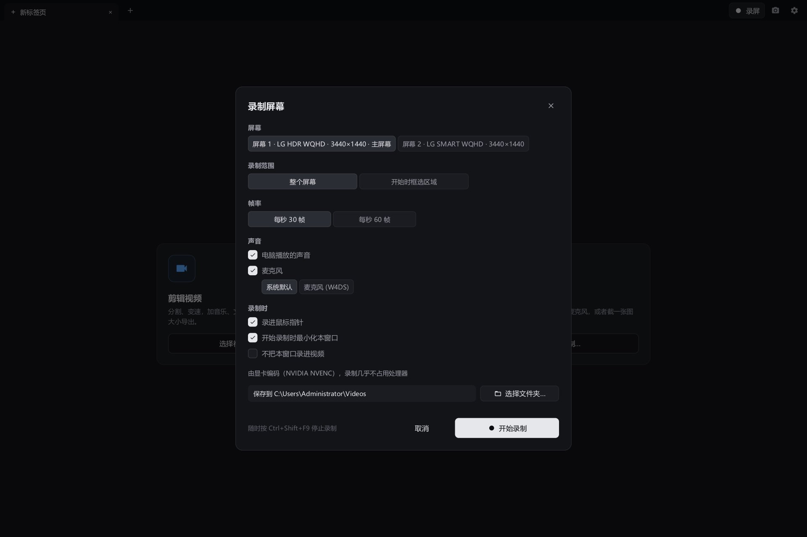

<p align="center"></p>

<h1 align="center">Btelo Forge</h1>

<p align="center">剪视频、画图、录屏，一个小巧的原生软件全都能做，支持 Windows 和 macOS。<br>
免费开源、离线可用，AI 也能通过 MCP 直接操作。</p>

<p align="center">
  <a href="https://github.com/btelolabs/btelo-forge/releases/latest"><b>下载</b></a> ·
  <a href="README.md">English</a> · <b>中文</b>
</p>

<p align="center"></p>

## 视频剪辑

- 标签页，各自独立的剪辑；再拖入视频，可以接在主轨末尾，也可以叠到上层轨道。
- 多轨时间线：视频、覆盖物（文字、图片和绘图）、音乐，上层轨道盖住下层。
- 分割、修剪、单片段 0.25×–4× 变速，声音变速不变调。
- 片段和整条轨道都能调音量，片段和覆盖物都能调不透明度；框选或 Ctrl 多选后一起修改。
- 导出预设从「高画质」到「极限压缩」，另有「指定大小」：两遍编码，压到你设定的文件大小以内。所有参数都可以单独调：分辨率、帧率、H.264 / H.265 / AV1、画质、编码速度、音频码率，有 NVIDIA 显卡时用显卡编码。
- 配乐：一次搜索 Kevin MacLeod、Openverse、ccMixter、Internet Archive 和 Freesound 音效，只收录可商用的许可，导出时自动在旁边写好需要的署名。
- 字幕：本机用 whisper.cpp 识别语音，六种模型，CPU 或 CUDA；字幕放在单独的轨道上，可以继续编辑。
- 预览和导出用同一套滤镜图，看到什么就导出什么。

<table>
  <tr>
    <td></td>
    <td></td>
  </tr>
</table>

## 绘图

<p align="center"></p>

**位图，像 Photoshop 一样**
- 画笔与橡皮擦（硬度、流量、平滑、笔尖形状、形状动态：大小与角度抖动、散布、笔尖随笔画转动）；12 个笔刷预设（铅笔、炭笔、针管笔、毛笔、鬃毛刷、海绵、喷溅等），也可用自己的图片做笔尖；仿制图章；减淡、加深、海绵、模糊、锐化、涂抹。
- 矩形/椭圆选框、套索、魔棒选区；油漆桶和渐变。
- 图层与编组，支持蒙版、26 种混合模式和锁定透明像素；调整图层只改变下方的显示效果、不动原像素；图层样式（投影、内阴影、外发光、内发光、描边、颜色叠加）随图层的每次修改自动更新。
- 色阶、曲线、色相/饱和度等调整，高斯模糊、USM 锐化、添加杂色、马赛克等滤镜，都带实时预览；自由变换含斜切、扭曲、透视、变形；历史记录面板。

**矢量，像 Affinity Designer 一样**
- 形状（矩形、椭圆、多边形、星形、直线）、钢笔，以及把手绘线条变成少量平滑曲线的铅笔。
- 编辑节点和控制柄的节点工具，布尔运算（相加、相减、相交、排除），吸附到节点、边和中心。
- 填充与描边设置：宽度、对齐、端点、拐角、虚线。矢量在任何缩放和导出中都保持清晰。

**画布**
- 无限画布：开始画之前不用设定尺寸。需要固定尺寸时加画板，每个画板单独导出为一张图片。
- 切图：按 K 把选中的图层、组或画板标记为切图（名字末尾自动加 .png），文件 › 导出切图 把它们逐个导出为 PNG，放在画布文件旁边。命名沿用 Krita 切图插件的规则——`assets/fish.png` 导出到子目录、`fish_300x200.png` 指定尺寸、`200x300/assets` 组把目录和尺寸传给其中的图层——每个切图旁的 ⓘ 会说明它将导出成什么、为什么是这个尺寸。
- 截图可以直接作为画布打开；也可以在视频上绘制覆盖物，画布每次保存，覆盖物随之更新。
- 画布文件完整保存所有内容：图层、矢量、文字、蒙版、效果、调整图层和画板。

<p align="center"></p>

## 脑图与流程图

- 思维导图和流程图同在一块无限画板上，像 XMind 加 Whimsical：导图里的主题可以连线，流程图的方框也能长出子树。树可以排成思维导图、逻辑图、组织结构图或大纲。
- 画板上的一切都是节点：主题和流程图形状、自由文字、带公式的表格（=SUM(B2:B9)）、图片和 GIF 动图、原地播放的视频、来自画布的智能对象（画布上每次修改都会同步过来），以及嵌套在里面的其它脑图——脑图如果绕一圈嵌套回自己，会显示一个 ⚠️ 提示节点，不会出错。
- 快捷键与 XMind 一致：Tab 添加子主题、Enter 添加同级主题、直接打字替换主题文字、方向键在主题间移动。把主题拖到另一个主题上就移过去，拖到空白处就变成自由节点；从方框四边的圆点拖出连线，拖到空白处会新建一个连好的方框。
- 为几十万个节点设计：画板按瓦片在所有 CPU 核心上绘制，只画视野内的部分，并有整块画板的缩略图。文件很小：图片和视频只是引用，从不复制。
- 素材管理里可以预览脑图，网格里显示整张脑图的缩略图。

## 录屏（Windows）

- 录制屏幕，同时录电脑声音和麦克风，做法与 OBS Studio 相同：桌面复制（Desktop Duplication）把画面直接交给显卡编码（NVIDIA NVENC、AMD AMF 或 Media Foundation），实测录制 3440×1440、每秒 60 帧只占单核处理器约 3%。
- 整个屏幕或选定区域；可以暂停和继续；在任何程序里都能用的热键（Ctrl+Shift+F9 开始和停止）；本软件的窗口默认也会录进去，方便录制操作演示，也可以设置成不录；录制工具栏不会出现在画面里。
- 录完直接在新标签页打开，马上可以剪辑。
- 截取整个屏幕或拖选区域，录屏或不录屏时都能直接在屏幕上绘制。

<p align="center"></p>

## 直播推流（Windows）

- 一播多推：同时推到 YouTube、Twitch、B 站、抖音、快手、视频号、虎牙、斗鱼，或任何 RTMP、RTMPS、SRT 服务器。画面只在显卡上编码一次，多推一个平台只多占上传带宽。
- 推流和录制互相独立，做法与 OBS 相同：录制时直播画面就是正在录的屏幕，不录时为黑屏；停止录制、或换个区域重新录制，都不会中断直播。
- 每个平台各自连接、断线自动重连、各自追赶进度，一个掉线不会拖累其他平台，直播中也能单独加入或停推某个平台。串流密钥以你的 Windows 账户加密保存。
- 平台列表是 JSON 配置：在 设置 → 扩展 里添加新平台，或者让 AI 帮你加。
- 摄像头可以以圆形或带描边的圆角矩形放在屏幕一角，录屏和直播都会带上；拖动可移动，拖右下角或滚动滚轮可调大小。

## AI 通过 MCP 操作

- 内置 MCP 服务：Claude、Codex、Cursor 等 MCP 客户端能做你用鼠标能做的事——剪辑视频、在画布上绘图、绘制和维护脑图、录制屏幕，并查看结果。
- 视频剪辑、绘图、脑图、录制（以及全部）各有独立的服务，AI 只会看到它需要的工具；设置里可以一键复制给 AI 的接入说明。
- 音乐网站、语音模型、直播平台和 ffmpeg 下载来源都是纯 JSON 配置，可以让 AI 改，也可以自己在设置里改。交给 AI 的串流密钥会加密保存，之后不会再显示给它。

<table>
  <tr>
    <td></td>
    <td></td>
  </tr>
</table>

## 其他

- 快捷键在设置中按类别分别自定义：通用、视频剪辑、绘图、录制。
- 手机在同一局域网里通过带私密口令的链接，播放和下载导出的视频，也能把视频传回电脑。
- 窗口在后台时不占用处理器：在有变化之前，什么都不绘制、什么都不检查。

## 下载

| 系统 | 文件 |
| --- | --- |
| Windows 10 / 11，x64 | `btelo-forge-windows-amd64.zip` |
| Windows ARM 版 | `btelo-forge-windows-arm64.zip` |
| macOS 11 及以上，Apple 芯片与 Intel | `btelo-forge-macos.zip` |

不需要另外安装任何东西：软件使用自带的 ffmpeg，保证录屏、直播、导出在每台电脑上表现一致——首次运行时自动下载一份静态版本到软件自己的目录，只下载一次（可以在 设置 → 扩展 → ffmpeg 里改为允许使用电脑上已安装的版本）。macOS 版已签名并通过 Apple 公证。macOS 上的 AI 字幕使用 Homebrew 安装的 `whisper-cli`。

Btelo Forge 原名 Btelo Video Cut，0.1.3 及更早的版本仍用旧名（`btelo-cut-*.zip`）。第一次运行 Btelo Forge 时，原来的设置、未完成的剪辑和已下载的内容会自动迁移过来。macOS 上软件换了新的身份标识，所以会重新请求录屏权限。

## 构建

需要 Go 1.27。Windows 不需要别的；macOS 需要 Xcode 命令行工具。

```
go build ./cmd/btelo-forge
go test ./...
```

Windows 上，`scripts\dev.ps1` 会从当前源码编译并打开软件；加 `-InstallShortcut` 会在桌面放一个做同样事情的快捷方式，改完代码双击即可试用。

Windows 上是纯 Go 实现（Win32，不用 cgo），macOS 上使用 Cocoa；界面由软件自己绘制，媒体处理全部交给 ffmpeg。画布的实现见 [docs/canvas-engine.md](docs/canvas-engine.md)。

## 许可

[Apache License 2.0](LICENSE)。第三方组件遵循各自的许可，见[第三方声明](THIRD_PARTY_NOTICES.md)。
